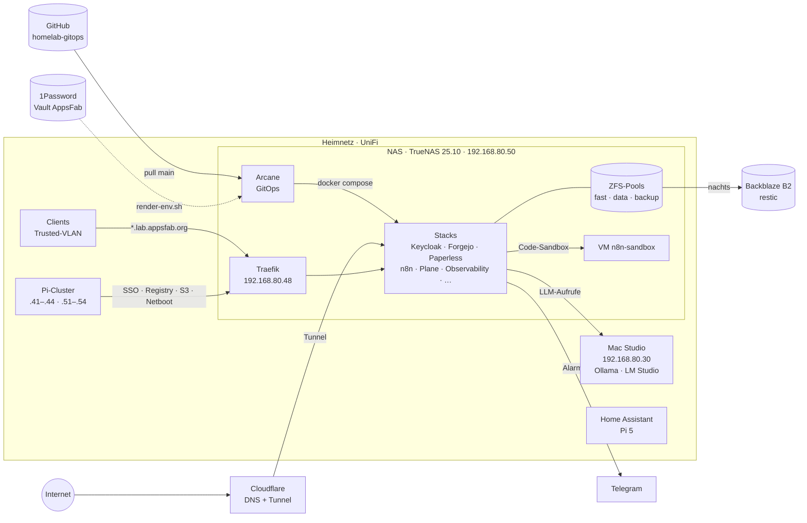

# Architektur

## Gesamtbild



## Bausteine

| Baustein | Rolle | Verwaltet durch |
|---|---|---|
| **NAS** (UGREEN DXP4800 Plus, 24 GB RAM, TrueNAS 25.10) | Führt alle Dienste aus, hält alle Daten | TrueNAS-UI + Skripte in [`docs/nas-backup`](../nas-backup/README.md) |
| **Arcane** (TrueNAS-App, v3.1.1) | Beobachtet dieses Repo; jeder Stack ist eine *Gitsync-App*, die bei Änderungen an `main` neu deployt | einmalig von Hand eingerichtet |
| **GitHub** `appwerkstatt/homelab-gitops` | Quelle der Wahrheit für alle Stack-Definitionen, CI (`validate`), Renovate | dieses Repo |
| **1Password** Vault `AppsFab` | einzige Quelle für Secrets | [Secrets](../sicherheit/secrets.md) |
| **Cloudflare** | DNS für `appsfab.org`, Tunnel für die drei öffentlichen Hosts, DNS-01 für Let's Encrypt | Dashboard + `stacks/12-cloudflared/config.yml` |
| **Mac Studio** (`192.168.80.30`) | lokale LLMs: Ollama (`:11434`) und LM Studio (`:1234`), nur vom NAS erreichbar | [Runbook](../mac-studio-llm.md) |
| **VM `n8n-sandbox`** (auf dem NAS) | Code-Sandbox des n8n-Assistenten, isoliert | [n8n-Sandbox](../extern/n8n-sandbox.md) |
| **Pi-Cluster** (Pi 4 + Pi 5) | Kubernetes-Lernumgebung, nutzt Keycloak, Zot, Garage und Netboot des NAS | [Cluster](../extern/cluster.md) |
| **Home Assistant** (eigener Pi 5) | Hausautomation, unabhängig vom NAS | [Außerhalb des NAS](../extern/index.md) |
| **Backblaze B2** | Offsite-Kopie (restic, verschlüsselt) | [Backup](../backup/index.md) |
| **Telegram** | Zustellung aller Alarme und des Tagesberichts | [Alarme](../monitoring/alerts.md) |

## Wie eine Anfrage ankommt

=== "Aus dem LAN"

    1. Client fragt `grafana.lab.appsfab.org`. Der UniFi-Gateway beantwortet `*.lab.appsfab.org` lokal
       (Split-Horizon) mit **Traefik `192.168.80.48`**.
    2. Traefik terminiert TLS mit dem Wildcard-Zertifikat `*.lab.appsfab.org` (Let's Encrypt, DNS-01).
    3. Hat der Router die Middleware `sso@docker`, fragt Traefik zuerst **oauth2-proxy**; ohne Sitzung geht
       es zum Login nach Keycloak (`auth.appsfab.org`).
    4. Traefik leitet über das Netz `edge-<stack>` an den Container weiter.

=== "Aus dem Internet"

    1. Nur `git.appsfab.org`, `auth.appsfab.org` und `hooks.appsfab.org` haben öffentliche DNS-Einträge
       (CNAME auf den Cloudflare-Tunnel).
    2. `cloudflared` auf dem NAS hält eine ausgehende Verbindung zu Cloudflare und reicht nur diese drei Hosts
       an `https://traefik:443` weiter; alles andere bekommt 404.
    3. Tunnel-Verkehr kommt aus dem Netz `edge-tunnel` (`172.31.253.0/24`). Weil das außerhalb der
       LAN-Allowlists liegt, sind Keycloak-Admin-Konsole und `master`-Realm von außen gesperrt (403).

## Startreihenfolge

```
GitHub (dieses Repo)
   └─> Arcane (TrueNAS-App, manuell installiert)
         └─> 00-traefik         (legt die Netze edge-<stack> an, TLS via DNS-01)
               └─> 01-forgejo + 02-keycloak   (Identität)
                     └─> 03-oauth2-proxy · 11-paperless · 12-cloudflared · 13-n8n · 14-plane
                         20-observability · 21-garage · 22-harbor (Zot) · 23-registry-cache
                         30-netboot · 40-homepage
```

Traefik muss vor jedem anderen Stack laufen, weil es die externen Netze `edge-<stack>` anlegt.
Keycloak muss laufen, bevor Dienste mit SSO starten. Der vollständige Ablauf für einen Neuaufbau steht unter
[Neuaufbau (DR)](../betrieb/neuaufbau.md).
