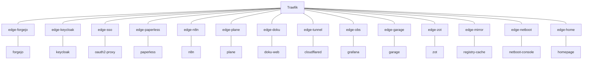

# Netzwerk & Domains

## VLANs und feste Adressen

Das Heimnetz läuft auf UniFi (Gateway: Cloud Gateway Ultra). Für das Homelab sind drei VLANs relevant.

| VLAN | Netz | Zweck | Wichtige Adressen |
|---|---|---|---|
| 80 „Kubernetes“ | `192.168.80.0/24` | Homelab-Dienste und Cluster | `.1` Gateway · `.30` Mac Studio · `.41–.44` Pi 4 · `.47` Netboot-nginx · `.48` Traefik · `.49` Netboot-dnsmasq · `.50` NAS (`enp3s0`) · `.51–.54` Pi 5 |
| 40 „Server“ | `192.168.40.0/24` | Server-Netz, Internet für die Sandbox-VM | `.168` NAS (`enp6s0`) · VM `n8n-sandbox` per DHCP |
| 10 „Trusted“ | `192.168.10.0/24` | Laptops, Desktop | `.1` Gateway/DNS · Christians Mac |

Dazu kommen rein NAS-interne Netze:

| Netz | Zweck |
|---|---|
| `br88` `10.88.88.0/30` | Host-Bridge ohne physisches Interface: NAS `.1` ↔ VM `n8n-sandbox` `.2` |
| `edge-<stack>` (Docker-Bridges) | ein Netz pro web-exponiertem Stack, siehe unten |
| `edge-tunnel` `172.31.253.0/24` | fest, damit Tunnel-Verkehr nie wie LAN aussieht |

!!! info "SSH zum NAS"
    Für SSH die Adresse im VLAN 80 nehmen (`192.168.80.50`, in `~/.ssh/config` als `truenas.server`).
    Verkehr an `192.168.40.168` kommt über `enp6s0` an, die Antwort geht aber über `enp3s0` raus
    (asymmetrisches Routing). Das funktioniert meist, ist aber fehleranfällig; Source-Routing wäre die
    saubere Lösung und ist noch nicht umgesetzt ([Roadmap](../roadmap.md)).

## Traefik auf eigener IP (macvlan)

Traefik hört nicht auf den Ports des NAS, sondern bekommt über das macvlan-Netz `vlan80` (Parent `enp3s0`)
eine eigene Adresse **`192.168.80.48`**. Damit kollidiert es nicht mit der TrueNAS-Web-UI auf `.50:80/443`,
und Git-over-SSH kann auf `.48:22` laufen, ohne den SSH-Dienst des NAS zu stören.

**Hairpin-Folge:** Linux lässt den Host nicht mit seinen eigenen macvlan-Kindern sprechen. Der NAS-Host
(`.50`) erreicht `.48` deshalb nicht. Dafür gibt es drei Muster:

- **NAS-lokale Ports auf `127.0.0.1`**: Zot `127.0.0.1:5000`, Registry-Cache `127.0.0.1:5001`. Der Docker-Daemon
  des NAS zieht darüber Images.
- **Netz-Aliase an Traefik**: In jedem `edge-<stack>` trägt Traefik die Aliase `auth.appsfab.org` und
  `auth.lab.appsfab.org` (in `edge-home` weitere). Ein Container, der serverseitig Keycloak aufruft
  (OIDC-Discovery, Token, JWKS), landet so über Docker-DNS direkt bei Traefik, ohne Hairpin und ohne Umweg
  übers Internet.
- **Fremde Hosts direkt**: Mac Studio und Pis sind eigene Geräte, dort gibt es kein Hairpin-Problem.

## Netze pro Stack (`edge-<stack>`)

Jeder Stack mit Web-Oberfläche hängt nur an seinem eigenen Netz. Traefik hängt an allen. Backends
sehen sich gegenseitig nicht und können `sso@docker` nicht umgehen.

Bewusste Ausnahmen, jeweils im `compose.yaml` kommentiert:

| Container | Zusätzliche Netze | Grund |
|---|---|---|
| blackbox-exporter | alle `edge-*` mit Backend | probt die Dienste direkt, ohne Traefik |
| Forgejo | `edge-netboot` | die Netboot-Konsole klont und pusht über `http://forgejo:3000` |
| VictoriaMetrics, Loki, Alertmanager | `edge-n8n` | n8n liest Metriken und Logs, Alertmanager ruft den Alert-Erklärer |

Die Netze legt **`00-traefik`** an (im Stack selbst `external: true`). Ein neuer Stack braucht deshalb
zuerst sein Netz in `00-traefik`, siehe [Neuen Stack anlegen](../betrieb/neuer-stack.md).

## Domains

!!! note "Regel"
    **`*.lab.appsfab.org` ist nur intern**, **`*.appsfab.org` ist für den Zugriff aus dem Internet.**
    Cloudflares kostenloses Edge-Zertifikat deckt nur eine Ebene (`*.appsfab.org`) ab; ein öffentlicher
    Name wie `auth.lab.appsfab.org` würde am TLS-Handshake scheitern.

| Name | Erreichbar | Ziel |
|---|---|---|
| `*.lab.appsfab.org` | nur LAN (UniFi beantwortet sie lokal mit `192.168.80.48`) | alle internen Dienste |
| `git.appsfab.org` | Internet (Tunnel) + LAN | Forgejo |
| `auth.appsfab.org` | Internet (Tunnel) + LAN | Keycloak-Login, Issuer aller OIDC-Clients |
| `hooks.appsfab.org` | Internet (Tunnel), nur `/webhook/` und `/webhook-test/` | n8n-Webhooks |

Alle anderen Hosts unter `appsfab.org` haben keinen öffentlichen Eintrag; der Tunnel beantwortet
Unbekanntes mit 404 (`stacks/12-cloudflared/config.yml`).

## TLS

- Traefik holt Zertifikate bei **Let's Encrypt per DNS-01** über die Cloudflare-API (`CF_DNS_API_TOKEN`).
  Das Wildcard `*.lab.appsfab.org` deckt alle internen Hosts ab; die öffentlichen Hosts bekommen eigene Zertifikate.
- Weil das Netz DNS abfängt (Split-Horizon), ist der lokale Propagations-Check aus; Traefik wartet fest 90 s.
- Zwischen Cloudflare und Traefik läuft ebenfalls TLS (`originServerName` je Host in `config.yml`).
- Der Alarm `CertExpiringSoon` meldet ablaufende Zertifikate ([Alarme](../monitoring/alerts.md)).

## DNS-Fallen

- Der UniFi-Gateway beantwortet A-Records für `*.lab` lokal, reicht AAAA aber nach außen weiter. Existiert
  öffentlich ein AAAA-Eintrag für einen internen Namen, bevorzugt macOS IPv6 und landet im Internet. Deshalb
  gibt es für `*.lab` keine öffentlichen Einträge.
- Unter macOS mit `dscacheutil -q host -a name <host>` prüfen, was der System-Resolver wirklich liefert;
  `dig` umgeht ihn.
