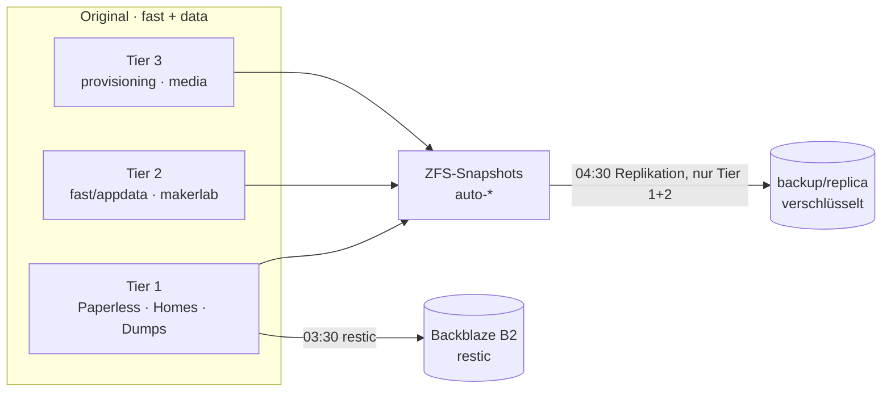

# Backup

Das Backup folgt **3-2-1**: Original auf `fast`/`data` (Mirrors), lokale Kopie auf der separaten
Disk `backup`, Offsite-Kopie verschlüsselt in Backblaze B2. Alles wird von Skripten im Repo angelegt
([`docs/nas-backup`](../nas-backup/README.md)), damit ein neu installiertes TrueNAS es wiederbekommt.



## Stufen

| Stufe | Datasets | Snapshots | Lokale Replika | Offsite |
|---|---|---|---|---|
| **Tier 1** unersetzlich | `data/paperless`, `data/homes`, `backup/HomeFolders`, `backup/dumps` | 00:00 + 12:00, 2 Wochen; sonntags 05:00, 8 Wochen | ja (außer Datasets auf `backup`) | ja |
| **Tier 2** wichtig | `fast/appdata` (alle App-Daten und DBs), `data/makerlab` | 03:00, 1 Woche; sonntags 05:00, 4 Wochen | ja | DB-Dumps + Plane-Uploads |
| **Tier 3** reproduzierbar | `data/provisioning`, `data/media` | 03:00, 1 Woche | nein | nein |
| **ohne** | `data/garage`, `data/harbor` (Zot), `data/registry-cache`, `fast/vm`, `fast/ix-apps` | – | – | – |

Bewusst ohne Backup: Garage (Cluster-Daten, Cluster wird neu aufgebaut), Zot (Images aus Forgejo neu baubar),
Registry-Cache, Sandbox-VM, App-Engine-Interna. Time Machine bleibt lokal (100-Mbit-Uplink).

## Nächtlicher Ablauf

| Zeit | Job | Quelle |
|---|---|---|
| 00:00, 12:00 | Tier-1-Snapshots | `snapshot-tasks.py` |
| 02:00–06:00 | Renovate-Zeitfenster (GitHub) | `renovate.json` |
| 02:30 | TrueNAS-Konfig-Export nach `backup/dumps/truenas-config` | `config-export.sh` |
| 03:00 | Tier-2- und Tier-3-Snapshots | `snapshot-tasks.py` |
| 03:30 | DB-Dumps + restic → B2, sonntags zusätzlich `restic check` (5 % der Daten) | `backup-offsite.sh` |
| 04:00 | **TrueNAS startet `middlewared` neu, hier nichts planen** | TrueNAS-Cron |
| 04:30 | lokale Replikation nach `backup/replica` | `replication-tasks.py` |
| 05:00 (So) | Wochen-Snapshots | `snapshot-tasks.py` |
| 07:30 | Tagesbericht per Telegram | n8n |

## Offsite im Detail

`backup-offsite.sh` läuft als TrueNAS-Cron und macht:

1. **App-konsistente Dumps** nach `/mnt/backup/dumps/<app>/`: `pg_dump` von Keycloak, Paperless, Plane, n8n
   und `forgejo dump`, gepackt mit `zstd --rsyncable` (dedupliziert gut). Lokal 14 Tage aufbewahrt.
2. **restic** (als Einmal-Container) sichert Dumps (inkl. Konfig-Export), Paperless-`media` und -`export`,
   `data/homes`, `backup/HomeFolders` und Plane-Uploads nach B2.
3. **Aufbewahrung**: 14 täglich, 8 wöchentlich, 12 monatlich (gruppiert nach Host + Tag).
4. **Metriken** für die Alarme `OffsiteBackupStale` (36 h ohne Erfolg) und `ReplicaBackupStale`.

Zugangsdaten stehen in `/mnt/fast/appdata/_secrets/restic-b2.env` und in 1Password.

## Änderungen ausrollen

Die Skripte laufen vom NAS, nicht aus Arcane. Nach einer Änderung im Repo:

```bash
scp -r docs/nas-backup truenas.server:/tmp/
ssh truenas.server 'sudo install -m 755 /tmp/nas-backup/*.sh /tmp/nas-backup/*.py /mnt/backup/scripts/nas-backup/   && sudo bash /mnt/backup/scripts/nas-backup/deploy.sh'
```

Die Dateien auf dem NAS gehören root, der SSH-Benutzer ist nicht root, deshalb der Umweg über `/tmp` und
`sudo install`. `deploy.sh` ist idempotent.

## Prüfen

```bash
midclt call pool.snapshottask.query | python3 -m json.tool | grep -c dataset   # Snapshot-Tasks
midclt call replication.query | python3 -c "import sys,json;[print(t['name'],t['state']['state']) for t in json.load(sys.stdin)]"
ls -l /mnt/backup/dumps/*/ | tail                                             # frische Dumps
```

Das Grafana-Dashboard *Homelab · Übersicht* zeigt das Alter des letzten Offsite-Laufs.
