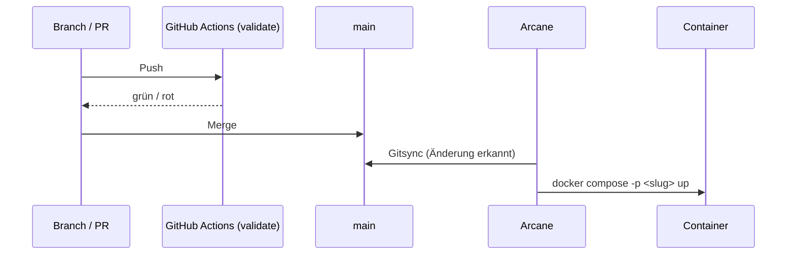

# Deploy & Updates

## Der Weg einer Änderung

1. Änderung auf einem Branch, PR gegen `main`.
2. **`validate`** muss grün sein (Pflicht-Check). Er prüft:
    - `renovate.json` gültig,
    - jede Compose-Variable steht in `.env.example` (`scripts/check-env.sh`),
    - jedes `compose.yaml` interpoliert ohne Warnung,
    - neu eingetragene Image-Tags existieren für `linux/amd64` (`scripts/check-images.sh`),
    - vmalert-Regeln, Alertmanager-, Blackbox-, Alloy- und Loki-Config sind gültig,
    - Grafana-Dashboards passen zu `build-dashboards.py`.
3. **Merge**: Christian merged (im Projekt-Chat mit „merge it“).
4. **Arcane deployt `main` sofort.** Jede Gitsync-App deployt neu, wenn sich ihr `compose.yaml` geändert hat.

## Was Arcane nicht automatisch macht

| Fall | Was zu tun ist |
|---|---|
| neue oder geänderte Env-Variable | `scripts/render-env.sh <stack>` → Arcane → Environment → Redeploy |
| neuer Stack | Gitsync-App von Hand anlegen, Name = `name:` im compose |
| nur eine gemountete Datei geändert | Zähler hochzählen (`KCC_REALM_REV`, `CF_INGRESS_REV`) oder Container von Hand neu starten |
| Grafana-Provisioning geändert | Grafana neu starten |
| Backup-Skripte geändert | auf das NAS kopieren ([Backup](../backup/index.md#anderungen-ausrollen)) |
| n8n-Workflow geändert | in n8n neu importieren |
| Ordner/Datasets für einen neuen Dienst | vorher von Hand anlegen (Befehle im compose-Kommentar oder README) |

## Reihenfolge bei abhängigen Änderungen

Wenn ein PR mehrere Stacks berührt, in dieser Reihenfolge deployen: **traefik → keycloak → betroffener Stack →
observability → homepage / cloudflared**. Traefik zuerst, weil es Netze und Aliase anlegt; Keycloak vor dem
Dienst, damit Client und Secret schon existieren.

## Renovate

- GitHub-App, der Workflow läuft **4× täglich** (01:41, 07:41, 13:41, 19:41 UTC; GitHub startet ihn oft
  Stunden später). Es gibt **kein Zeitfenster** in `renovate.json`: Jeder Lauf darf PRs anlegen und
  aktualisieren. Ein Nachtfenster passt nicht zum verspäteten Cron, Updates blieben sonst wochenlang unter
  *Awaiting Schedule* liegen.
- **Patch und Digest** werden nach grünem `validate` automatisch gemergt und damit sofort deployt, aber erst
  **3 Tage nach dem Upstream-Release** (`minimumReleaseAge`, gegen manipulierte Releases). Einen dringenden
  Sicherheits-Patch holt man früher über das Häkchen im Dependency-Dashboard.
- Den Status-Check `renovate/stability-days` setzt Renovate bewusst **nicht**
  (`statusCheckNames.minimumReleaseAge: ""`). Ohne Schreibrecht der App auf *Commit statuses* bricht Renovate
  sonst den ganzen Lauf mit `Repository has changed during renovation` ab (siehe [Fehlersuche](fehlersuche.md#renovate-legt-keine-prs-mehr-an)).
- Manueller Lauf: *Actions → renovate → Run workflow*, bei Problemen mit `log_level: debug`.
- GitHub Actions sind auf Commit-Digests gepinnt (`helpers:pinGitHubActionDigests`).
- **Minor** als PR zum Prüfen, **Major** erst nach Freigabe im Dependency-Dashboard.
- **Postgres und Redis**: Majors sind abgeschaltet (Datenmigration nötig, Vorfall 2026-06-05).
- Gruppen: alle `makeplane/*`-Images gemeinsam; SearXNG mit eigenem Versionsschema.
- Das restic-Image im Backup-Skript wird über einen Regex-Manager mitgepflegt.

Den Stand fasst der Tagesbericht um 07:30 zusammen.

## Rückgängig machen

Ein schlechter Deploy wird per **Revert-PR** zurückgenommen, nicht durch Eingriffe in Arcane. Bei Datenbanken
kann ein Image-Rollback allein scheitern, wenn die neue Version das Schema migriert hat. Dann Snapshot von
`fast/appdata/<dienst>` aus der Zeit vor dem Deploy nehmen ([Wiederherstellung](../backup/restore.md#2-ganzes-dataset-zuruckrollen)).
