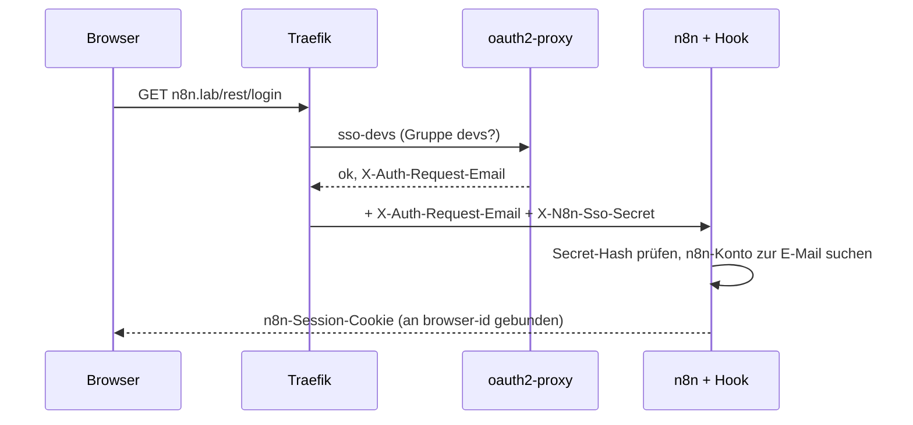

# 13-n8n

| | |
|---|---|
| **Zweck** | Workflow-Automatisierung: Tagesbericht, PR-Meldungen, Alert-Erklärer, eigene Automationen |
| **Adresse** | Editor `https://n8n.lab.appsfab.org`; Webhooks öffentlich `https://hooks.appsfab.org/webhook/…` |
| **Login** | `sso-devs@docker` (Gruppe `devs`, siehe [Rechtekonzept](../sicherheit/rechtekonzept.md)), danach automatisch im n8n-Konto mit derselben E-Mail ([Keycloak-Login](#keycloak-login)) |
| **Daten** | `fast/appdata/n8n/{data,db}` |
| **Backup** | Tier 2 + `pg_dump` offsite |
| **Abhängig von** | Mac Studio (Ollama `:11434`, LM Studio `:1234`), VM `n8n-sandbox`, vmauth (Metriken/Logs lesen, nur mit Token) |
| **Quelle** | [`stacks/13-n8n/`](https://github.com/appwerkstatt/homelab-gitops/blob/main/stacks/13-n8n) |

## Bausteine

- **n8n** + **n8n-db** (Postgres 17). Ausführungen werden nach 14 Tagen gelöscht.
- **searxng**: Metasuche für den n8n-Assistenten, nur im Stack-Netz.
- **Assistent (Instance AI)**: Modell über LM Studio auf dem Mac Studio (OpenAI-kompatibel), kein Cloud-Modell.
  Code führt er in der [Sandbox-VM](../extern/n8n-sandbox.md) aus.
- **Ollama-Credential**: Die Base-URL ist im Stack fest vorgegeben (`CREDENTIALS_OVERWRITE_DATA`).

## Keycloak-Login

Die Community-Edition hat kein OIDC (das ist eine lizenzpflichtige Funktion, die wir **nicht** freischalten).
Stattdessen übernimmt ein eigener External Hook,
[`hooks/keycloak-sso.js`](https://github.com/appwerkstatt/homelab-gitops/blob/main/stacks/13-n8n/hooks/keycloak-sso.js),
die Identität, die Keycloak schon geprüft hat:



- Angemeldet wird nur ein **schon vorhandenes** n8n-Konto mit derselben E-Mail wie in Keycloak. Neue Konten
  legt der Hook nicht an, Rollen (Owner/Member) bleiben in n8n. Gibt es kein Konto, erscheint die normale
  n8n-Anmeldung.
- Den Header `X-N8n-Sso-Secret` setzt Traefik nur auf dem Editor-Router (hinter `sso-devs`). n8n kennt nur den
  SHA-256 (1Password `homelab-n8n`: `sso-secret` und `sso-secret-sha256`). Ein Workflow, der n8n über
  `localhost` aufruft, oder ein anderer Container in `edge-n8n` kann sich damit nicht als jemand anderes
  anmelden. Auf den Webhook-Routern entfernt Traefik beide Header (`n8n-strip-sso`).
- **Abmelden:** „Sign out“ in n8n meldet sofort wieder an, solange die Keycloak-Sitzung läuft. Ganz abmelden:
  `https://n8n.lab.appsfab.org/oauth2/sign_out`.
- **n8n-Updates:** Der Hook nutzt n8n-Interna (`AuthService`, Express-Router). Die CI startet bei jedem PR, der
  `stacks/13-n8n/` ändert (also auch bei Renovate), die neue n8n-Version mit dem Hook und prüft den Login samt
  Negativfällen im echten Browser (`scripts/check-n8n-sso-hook.sh`). Passt im Betrieb trotzdem etwas nicht,
  schaltet sich der Hook ab, loggt `keycloak-sso: DEAKTIVIERT: …` und der Alarm `N8nSsoHookDisabled` kommt.
  n8n läuft dann mit dem eigenen Passwort-Login weiter.

### Einrichten

1. Secret erzeugen und in 1Password `homelab-n8n` speichern:
   ```bash
   s=$(openssl rand -hex 32); printf '%s\n' "$s"; printf %s "$s" | sha256sum | cut -d' ' -f1
   ```
   Erste Zeile → Feld `sso-secret`, zweite → `sso-secret-sha256`.
2. `scripts/render-env.sh n8n` in Arcane → n8n → Environment einfügen (neu: `N8N_SSO_SECRET`, `N8N_SSO_SECRET_SHA256`), Stack neu deployen.
3. Im n8n-Log steht `keycloak-sso: aktiv`. Die E-Mail jedes n8n-Kontos muss der Keycloak-E-Mail entsprechen
   (n8n → *Settings → Personal*), und in Keycloak muss „Email verified“ an sein.

## Webhooks

| Pfad | LAN (`n8n.lab`) | Internet (`hooks.appsfab.org`) |
|---|---|---|
| `/webhook/`, `/webhook-test/` | ja, ohne SSO | ja, mit Rate-Limit |
| `/webhook-waiting/` | ja | nein (404) |
| Editor, API | nur mit SSO | nein (404) |

Jeder öffentliche Webhook sichert sich selbst ab (Header-Auth oder Signaturprüfung im Webhook-Node).

## Workflows im Repo

Die JSON-Dateien in [`stacks/13-n8n/workflows/`](https://github.com/appwerkstatt/homelab-gitops/blob/main/stacks/13-n8n/workflows) werden **von Hand** importiert;
Arcane deployt sie nicht. Einrichtung steht im [README](https://github.com/appwerkstatt/homelab-gitops/blob/main/stacks/13-n8n/workflows/README.md).

| Workflow | Was er tut |
|---|---|
| `tagesbericht.json` | 07:30 Telegram-Bericht: Alarme der letzten 24 h + Renovate-Status |
| `github-prs.json` | meldet neue PRs in `homelab-gitops` nach Telegram |
| `alert-erklaerer.json` | holt bei jedem Alarm die Logs aus Loki und lässt LM Studio erklären, Antwort als zweite Telegram-Nachricht |

## Stolperfallen

- **Encryption-Key** (`homelab-n8n/encryption-key`) nie neu erzeugen, solange die DB existiert, sonst sind
  alle gespeicherten Credentials unlesbar.
- Ist der Mac Studio aus, schlagen LLM-Nodes fehl; Workflows sollten Retry und einen Error-Workflow haben
  ([Mac-Studio-Runbook](../mac-studio-llm.md#6-plan-b-wenn-der-mac-aus-ist)).
