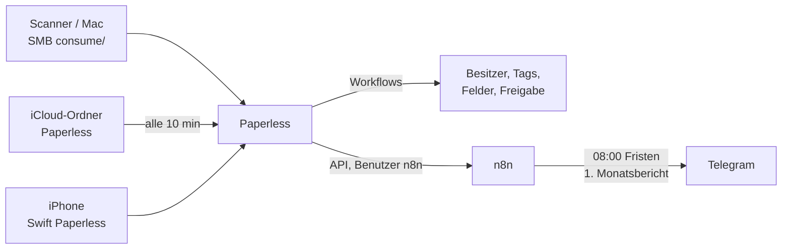

# 11-paperless

| | |
|---|---|
| **Zweck** | Dokumentenarchiv mit OCR (Paperless-ngx), eingebauter KI (Vorschläge + Chat) und paperless-ai (läuft aus) |
| **Adresse** | `https://docs.lab.appsfab.org`, `https://docs-ai.lab.appsfab.org` |
| **Login** | Paperless: Keycloak (OIDC, Client `paperless`) auf das eigene Paperless-Konto, siehe [Keycloak-Login](#keycloak-login); paperless-ai: `sso-admin@docker` (nur `lab-admins`) |
| **Daten** | `data/paperless/{media,consume,export}`, `fast/appdata/paperless/{db,redis,data}`, `fast/appdata/paperless-ai` |
| **Backup** | Dokumente Tier 1 (alle 12 h) + offsite; DB Tier 2 + `pg_dump` offsite |
| **Abhängig von** | Ollama auf dem Mac Studio (`192.168.80.30:11434`) für die KI (eingebaut und paperless-ai) |
| **Quelle** | [`stacks/11-paperless/compose.yaml`](https://github.com/appwerkstatt/homelab-gitops/blob/main/stacks/11-paperless/compose.yaml) |

## Bausteine

- **paperless** + **paperless-db** (Postgres 17) + **paperless-redis** (Celery-Broker, zustandslos).
- **paperless-ai**: Modell `qwen2.5:14b`, Embeddings `nomic-embed-text` über Ollama; die RAG-Embeddings
  rechnet v4 lokal, daher `mem_limit: 2g`.
- Neue Dokumente kommen über den SMB-Eingang `data/paperless/consume`, per Mail (iCloud) oder per App/Web-Upload,
  siehe [Automatisierung](#automatisierung).
- OCR läuft auf Deutsch + Englisch (`PAPERLESS_OCR_LANGUAGE: deu+eng`).

## Automatisierung

Felder, Tags, Workflows, Ansichten und das Mail-Postfach richtet
[`setup/paperless-setup.py`](https://github.com/appwerkstatt/homelab-gitops/blob/main/stacks/11-paperless/setup/paperless-setup.py)
über die API ein. Das Skript ist idempotent: Es legt nur an, was fehlt, und lässt Bestehendes (gleicher Name) in Ruhe.
`--update` überschreibt Workflows und Ansichten mit dem Stand aus dem Repo. Die CI startet bei jeder Änderung an
Paperless (auch bei Renovate) ein frisches Paperless und prüft das Skript samt Rechten und n8n-Abfragen
(`scripts/check-paperless-setup.sh`).



### Was das Skript anlegt

| Art | Inhalt |
|---|---|
| **Custom Fields** | `Betrag` (EUR), `Fällig am`, `Bezahlt` (Ja/Nein), `Vertragsende`, `Kündigen bis`, `Steuerjahr` |
| **Tags** | `Rechnung`, `Vertrag`, `Versicherung`, `Steuer`, `Haushalt` (Auto-Zuordnung über Stichwörter), `E-Mail`. Ohne Besitzer, damit alle Konten sie sehen; die Dokumente bleiben trotzdem privat |
| **Workflows** | siehe unten |
| **Ansichten** | *Rechnungen offen* (nach Fälligkeit), *Verträge mit Frist* (nach „Kündigen bis“), *Steuer &lt;Jahr&gt;* (Vorjahr + laufendes Jahr), *Steuer: ohne Steuerjahr*. Geteilt mit `haushalt` |
| **Benutzer `n8n`** | sieht und ändert nur Rechnungen, Verträge, Versicherungen und Steuer (per Workflow freigegeben), um leere Felder zu füllen |

Workflows (die Reihenfolge zählt, spätere Zuweisungen gewinnen):

| Workflow | Auslöser | Wirkung |
|---|---|---|
| Consume-Ordner: Besitzer christian | Datei in `consume/` | Besitzer `christian` (sonst hätte der Scan keinen Besitzer und alle sähen ihn) |
| Consume-Ordner gisa/ | Datei in `consume/gisa/` | Besitzer `gisa` |
| Consume-Ordner haushalt/ | Datei in `consume/haushalt/` | Besitzer `christian` + Tag `Haushalt` |
| Gemeinsam: mit haushalt teilen | Tag `Haushalt`, `Vertrag`, `Versicherung` oder `Steuer` | Ansehen + Bearbeiten für `haushalt` ([Rechtekonzept](../sicherheit/rechtekonzept.md#paperless-private-und-gemeinsame-dokumente)) |
| Rechnung: Felder | Tag `Rechnung` | Felder Betrag, Fällig am, Bezahlt + Leserecht `n8n` |
| Vertrag: Felder | Tag `Vertrag` oder `Versicherung` | Felder Vertragsende, Kündigen bis + Leserecht `n8n` |
| Steuer: Feld Steuerjahr | Tag `Steuer` | Feld Steuerjahr + Leserecht `n8n` |

**Englische KI-Tags:** Gibt es Tags wie `invoice`, `contract`, `insurance`, `tax` (legen paperless-ai bzw. die
Paperless-KI an), zählen sie in Workflows, Ansichten und Backfill wie der deutsche Tag (`TAG_ALIASES` im Skript;
Entscheidung 2026-11-28: beide Sprachen akzeptieren). Kommt ein neuer englischer Tag dazu: Skript mit
`--update --backfill` erneut laufen lassen.

**Reihenfolge mit der KI:** Der UI-Workflow „AI Kategorisierung“ (*Apply AI Suggestions*) muss eine **kleinere**
Sortierung haben als die Workflows hier (z. B. 5), sonst prüfen diese die Tags, bevor die KI sie setzt.

Die Tag-Workflows laufen beim Hinzufügen **und** beim Bearbeiten, also auch, wenn paperless-ai oder jemand von Hand
später den Tag setzt. Vorhandene Werte in Feldern überschreiben sie nicht. Leere Felder füllt der n8n-Workflow
`paperless-felder-ki.json` per Ollama aus (Tag **KI-Felder** danach; die eingebaute Paperless-KI kann keine Custom
Fields), von Hand geht es immer; Fälligkeit und „Kündigen bis“ sind die Grundlage für die Telegram-Erinnerungen.

**Hinweis:** Auch Dokumente der Kinder mit Tag `Vertrag`, `Versicherung` oder `Steuer` werden mit `haushalt` (den
Eltern) geteilt.

### Einrichten

1. In Paperless als Christian (Superuser) → Profil → **API-Token** erzeugen, in 1Password `homelab-paperless`,
   Feld `setup-api-token` (darf danach gelöscht oder neu erzeugt werden).
2. Vom Mac (Trusted-VLAN, `docs.lab` erreichbar), erst nur ansehen:
   ```bash
   export PAPERLESS_TOKEN=$(op read op://AppsFab/homelab-paperless/setup-api-token)
   python3 stacks/11-paperless/setup/paperless-setup.py --dry-run --n8n-user --backfill
   ```
3. Wenn die Ausgabe passt, ohne `--dry-run`. Die Zeile `n8n-Token: …` erscheint nur einmal: in 1Password
   `homelab-paperless`, Feld `n8n-api-token` ablegen.
4. Auf dem NAS die Unterordner anlegen (Besitzer wie der Consume-Ordner):
   ```bash
   cd /mnt/data/paperless/consume && sudo install -d -o "$(stat -c %u .)" -g "$(stat -c %g .)" christian gisa haushalt
   ```
5. `PAPERLESS_OCR_LANGUAGE` und `PAPERLESS_CONSUMER_RECURSIVE` kommen mit dem Merge (Arcane deployt main). Ältere
   Dokumente behalten ihre englische OCR; bei Bedarf einzeln *Erneut verarbeiten*.

### Scanner, Mac und iPhone

- **Scanner / Mac:** SMB-Freigabe des Consume-Ordners. Scans nach `christian/`, `gisa/` oder `haushalt/` legen,
  dann stimmen Besitzer und Freigabe sofort. Direkt in `consume/` landet alles bei Christian. Unterordner mit anderen
  Namen werden auch verarbeitet, Besitzer ist dann Christian.
- **iPhone:** App **Swift Paperless** (App Store), Server `https://docs.lab.appsfab.org`, Anmeldung mit einem
  **API-Token** (Profil → API-Token) statt Passwort; der Keycloak-Login gilt nur im Browser. `docs.lab` ist nur im
  Heimnetz erreichbar, unterwegs nur über VPN. Hochladen über das Teilen-Menü (Fotos, PDFs, Scans der Dateien-App).

### Mail-Import (iCloud)

Paperless holt alle 10 Minuten die **Anhänge** aus dem iCloud-Ordner `Paperless`, legt sie mit Tag `E-Mail` und
Besitzer Christian ab und verschiebt die Mail danach nach `Paperless-Erledigt`. Mails älter als 90 Tage bleiben
liegen.

1. In iCloud Mail (icloud.com oder Mail-App) die Ordner **`Paperless`** und **`Paperless-Erledigt`** anlegen.
   Belege dorthin ziehen oder eine Regel anlegen (icloud.com → Mail → Einstellungen → Regeln), z. B. alles an eine
   eigene Adresse wie `belege@<eigene Domain>` → Ordner `Paperless`.
2. **App-spezifisches Passwort** erzeugen (account.apple.com → Anmeldung und Sicherheit → App-spezifische
   Passwörter), in 1Password `homelab-paperless`, Feld `mail-app-password`. Login-Name ist die **@icloud.com-Adresse**
   (bzw. Apple-ID), nicht der Alias der eigenen Domain.
3. Vom Mac:
   ```bash
   export PAPERLESS_TOKEN=$(op read op://AppsFab/homelab-paperless/setup-api-token)
   export PAPERLESS_MAIL_USER=<name>@icloud.com
   export PAPERLESS_MAIL_PASSWORD=$(op read op://AppsFab/homelab-paperless/mail-app-password)
   python3 stacks/11-paperless/setup/paperless-setup.py --mail
   ```
   Das Skript prüft den IMAP-Login zuerst (`imap.mail.me.com:993`, SSL). Ein neues App-Passwort trägt derselbe
   Aufruf nach.

### Steuer-Export

Steuerdokumente bekommen das Feld **Steuerjahr** (das Jahr, für das sie gelten; die Lohnsteuerbescheinigung 2025
kommt erst 2026). Für die Erklärung: Ansicht **Steuer 2025** öffnen → alle auswählen → **Herunterladen** →
*Originale* → ZIP. Die Ansicht *Steuer: ohne Steuerjahr* zeigt, was noch fehlt; der Monatsbericht nennt die Zahl.
Neues Jahr: `paperless-setup.py` erneut laufen lassen (legt *Steuer &lt;Jahr&gt;* für Vorjahr und laufendes Jahr an).

### Erinnerungen über n8n

`paperless-fristen.json` (täglich 08:00, nur wenn etwas ansteht) und `paperless-monatsbericht.json` (am 1., 08:15)
in [`stacks/13-n8n/workflows/`](https://github.com/appwerkstatt/homelab-gitops/blob/main/stacks/13-n8n/workflows),
Einrichtung im [README](https://github.com/appwerkstatt/homelab-gitops/blob/main/stacks/13-n8n/workflows/README.md).
Sie lesen über `https://docs.lab.appsfab.org/api` mit dem Token des Benutzers `n8n` (im Netz `edge-n8n` über den Traefik-Alias `docs.lab`, sonst Hairpin).

## Eingebaute KI

Seit 3.0 hat Paperless eine eigene KI. Sie soll paperless-ai ablösen: erst laufen beide parallel, wenn die
eingebaute reicht, fliegt paperless-ai samt `docs-ai`-Router, API-Token und `fast/appdata/paperless-ai` raus.

- **Konfiguration** im `compose.yaml` (`PAPERLESS_AI_*`): Backend Ollama, Modell `qwen2.5:14b`, Embeddings
  `nomic-embed-text`, beides auf dem Mac Studio. Werte, die in der UI unter Einstellungen gespeichert sind,
  gewinnen gegen die Variablen.
- **Vorschläge** (Titel, Tags, Korrespondent, Dokumenttyp, Speicherpfad, Datum): auf der Dokumentseite über
  den Vorschlag-Button. Automatisch für neue Dokumente über einen Workflow mit der Aktion
  *Apply AI Suggestions* (in der UI anlegen). Gelesen werden nur die ersten ~4.000 Zeichen.
- **Chat** über alle sichtbaren Dokumente oder ein einzelnes Dokument. Er sucht nur in Dokumenten, die die
  angemeldete Person sehen darf, darum für alle Konten nutzbar (paperless-ai nur für `lab-admins`).
- **Index** in `fast/appdata/paperless/data/llm_index` (SQLite), damit im normalen Backup. Update nachts
  02:10. Nach dem ersten Deploy und nach jedem Wechsel des Embedding-Modells einmal bauen:
  `docker exec paperless-paperless-1 document_llmindex rebuild`.
- Fehlt gegenüber paperless-ai: eigene Prompts und KI-Befüllung von Custom Fields.

## Keycloak-Login

Paperless meldet über **allauth** (`openid_connect`, Provider-ID `keycloak`) bei Keycloak an. Das ist eine
freie Funktion von Paperless-ngx, nichts wird gepatcht.

- **Keine neuen Konten:** `PAPERLESS_SOCIALACCOUNT_ALLOW_SIGNUPS=false`. Wer in Keycloak ist, aber kein
  verknüpftes Paperless-Konto hat, sieht „Sign Up Closed“. Konten, Rechte und die Gruppe `haushalt` bleiben
  in Paperless; Keycloak-Gruppen werden **nicht** übernommen.
- **Verknüpfen (einmal pro Person):** mit dem Paperless-Passwort anmelden → Profil (oben rechts) →
  Abschnitt *Connected social accounts* → **Keycloak** → Passkey. Ab dann reicht der Button „Keycloak“ auf der
  Login-Seite. Prüfen als Superuser: Django-Admin → *Social accounts*.
- **API und Apps:** paperless-ai, Homepage, n8n und Handy-Apps nutzen API-Tokens und merken nichts.

### Rollout

1. `openssl rand -base64 32 | tr -d '/+='` → 1Password `homelab-paperless`, Feld `oidc-client-secret`.
2. `scripts/render-env.sh keycloak` und `scripts/render-env.sh paperless` in die Arcane-Envs einfügen
   (`PAPERLESS_OIDC_CLIENT_SECRET` in **beiden**), erst Keycloak deployen, dann Paperless.
3. Alle vier verknüpfen ihr Konto (siehe oben). Die Konten in Paperless brauchen dafür nichts Besonderes.
4. **Schritt 2**, wenn alle verknüpft haben: im `compose.yaml` `PAPERLESS_DISABLE_REGULAR_LOGIN` und
   `PAPERLESS_REDIRECT_LOGIN_TO_SSO` auf `"true"`. Dann springt die Login-Seite direkt zu Keycloak und das
   Passwortformular ist aus.

**Achtung:** Auch mit `DISABLE_REGULAR_LOGIN` nimmt die **API** weiter Benutzername + Passwort an (Basic Auth,
`/api/token/`, getestet mit 3.4.1). Nach Schritt 2 die Paperless-Passwörter darum auf lange Zufallswerte
setzen (Christian: in 1Password `homelab-paperless` als Notzugang ablegen), sonst umgeht ein erratenes
Passwort den Passkey.

**Notausgang (Keycloak weg):** Schritt 2 zurückdrehen, dann geht das Passwort wieder; oder im Container
`python3 manage.py changepassword <user>`.

## Stolperfallen

- **paperless-ai meldet HTTP 400 („does not accept the host name paperless“):** Seit Paperless 3.5 sind
  nur der Host aus `PAPERLESS_URL` und `localhost` erlaubt. `PAPERLESS_ALLOWED_HOSTS: paperless` im
  `compose.yaml` muss bleiben, weil paperless-ai intern `http://paperless:8000` aufruft.
- **„Sign Up Closed“ nach dem Keycloak-Login:** Das Konto ist noch nicht verknüpft. Mit Passwort anmelden und
  im Profil verbinden (vor Schritt 2), sonst als Superuser im Django-Admin einen *Social account* anlegen
  (Provider `keycloak`, UID = Keycloak-User-ID).
- **Paperless-eigene 2FA (TOTP):** Wer sie eingerichtet hat, wird nach dem Keycloak-Login noch einmal gefragt
  (Keycloak schickt kein `amr`-Claim). Sie kann aus, Keycloak verlangt schon den Passkey.
- **Abmelden** beendet nur die Paperless-Sitzung; die Keycloak-Sitzung bleibt, der nächste Klick auf
  „Keycloak“ meldet sofort wieder an.

- Ist der Mac Studio aus, laufen KI-Vorschläge, Chat und paperless-ai ins Leere; Alarm `LlmHostDown`.
  Paperless selbst (OCR, Suche, Ablage) läuft weiter.
- Postgres nicht auf 18 heben (Vorfall 2026-06-05); Renovate macht das bewusst nicht.
- **Scan ohne Besitzer:** Fehlt der Workflow „Consume-Ordner: Besitzer christian“, sieht jedes Konto den Scan.
  Prüfen: Dokumente → Filter „Besitzer: keiner“.
- **Mail-Import holt nichts:** Paperless → Mail → Konto testen; App-Passwort abgelaufen oder Ordnername falsch
  geschrieben (Groß/klein zählt). Fehler stehen im Paperless-Log (`paperless_mail`).
