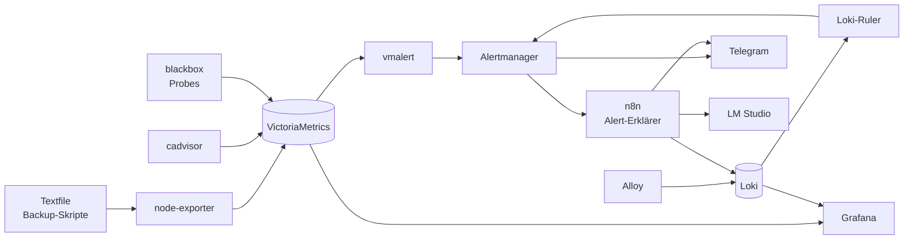

# Monitoring



## Metriken

- **VictoriaMetrics** (12 Monate) sammelt von node-exporter (NAS-Host, ZFS), cadvisor (Container, mit Stack-Label),
  blackbox (Probes), vmalert und Alertmanager. Scrape-Konfiguration: `stacks/20-observability/config/scrape.yml`.
- **Probes** laufen direkt über die `edge`-Netze, nicht über Traefik:
  HTTP-Health von Keycloak, Forgejo, Grafana, oauth2-proxy, Garage, Registry-Cache, n8n, Plane; Zot (`401` = lebt);
  Paperless; Ollama und LM Studio auf dem Mac Studio; TLS-Zertifikat über Traefik.
- **Textfile-Metriken**: `backup-offsite.sh` schreibt Zeitstempel des letzten Offsite-Laufs und der neuesten
  Replika-Snapshots nach `/mnt/fast/appdata/node-exporter/textfile/`.

## Logs

**Alloy** liest über einen eigenen read-only socket-proxy alle Container-Logs des NAS und schickt sie an **Loki**
(Dateisystem, 31 Tage). Labels: `compose_project`, `compose_service`, `container`. In Abfragen besser
`compose_service` nehmen, weil Arcane den Projektnamen setzt.

```logql
{compose_service="keycloak"} |= "LOGIN_ERROR"
```

## Dashboards

Ordner **Homelab** (erzeugt von [`build-dashboards.py`](https://github.com/appwerkstatt/homelab-gitops/blob/main/stacks/20-observability/build-dashboards.py)):

| Dashboard | Inhalt |
|---|---|
| Homelab · Übersicht | Dienste, Alarme, Auslastung, Pools, Backup-Alter auf einen Blick |
| Homelab · NAS-Host | CPU, RAM inkl. ZFS-ARC, Pools, Platten, Temperaturen |
| Homelab · Container & Stacks | CPU, RAM gegen `mem_limit`, Netz, Restarts, OOM je Stack |
| Homelab · Dienste & Erreichbarkeit | Probes, Verfügbarkeit, Antwortzeiten, TLS |
| Homelab · Alerts | Regeln, Verlauf, Zustellkette |
| Homelab · Logs | Container-Logs mit Filter nach Stack, Container, Suchbegriff |

Ordner **Community**: Dashboards von grafana.com (`fetch-dashboards.sh`). Alle Dashboards sind in der UI read-only.

**Dashboard ändern**: `build-dashboards.py` bearbeiten, `python3 stacks/20-observability/build-dashboards.py`
ausführen, Skript **und** JSONs committen. Die CI bricht ab, wenn sie nicht zusammenpassen.

## Berichte

- **Tagesbericht** 07:30 per Telegram: Alarme der letzten 24 h und Renovate-Status (n8n-Workflow `tagesbericht`).
- **PR-Meldungen**: neue PRs in `homelab-gitops` (n8n-Workflow `github-prs`).
