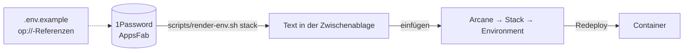

# Secrets (1Password)

**1Password, Vault `AppsFab`, ist die einzige Quelle der Wahrheit.** Das Repo sagt nur, *welche* Secrets es
gibt und *wo* sie in 1Password liegen. Die Arcane-Env ist nur die Laufzeit-Kopie.



## Bestandteile

- **[`.env.example`](https://github.com/appwerkstatt/homelab-gitops/blob/main/.env.example)** listet jede Variable, die ein `compose.yaml` per `${VAR}` liest:
  Secrets als `op://AppsFab/<item>/<feld>`, unkritische Werte im Klartext.
- **`scripts/check-env.sh`** (CI): schlägt fehl, wenn ein Stack eine Variable nutzt, die dort fehlt.
- **`scripts/render-env.sh <stack>`**: gibt genau die Variablen eines Stacks mit aufgelösten Werten aus.
  Braucht die 1Password-CLI `op`, die nur auf Christians Mac angemeldet ist.

## Abläufe

**Env eines Stacks setzen**

```bash
scripts/render-env.sh keycloak | pbcopy   # auf dem Mac
```

Dann in Arcane → Stack → *Environment* einfügen → *Redeploy*. Nie in eine Datei im Repo umleiten.

**Secret rotieren**: zuerst in 1Password ändern, dann `render-env.sh` und in Arcane setzen. Nie nur in Arcane
ändern, sonst driftet die Quelle.

**Neue Variable**: im `compose.yaml` nutzen, in `.env.example` mit `op://`-Referenz eintragen, Feld in
1Password anlegen. Alles im selben PR.

## Datei-Secrets

Manche Dienste brauchen Dateien statt Variablen. Sie liegen auf dem NAS unter `fast/appdata/…` (`chmod 600`)
und als **Dokument** in 1Password; die Zuordnung steht unten in `.env.example`.

| Datei | Dienst |
|---|---|
| `cloudflared/credentials.json` | Tunnel |
| `registry/htpasswd` | Zot-Robots `ci`, `pull` |
| `netboot-console/wipe-ssh.key` | Netboot-Konsole |
| `forgejo/jwt/private.pem` | Forgejo |
| `_secrets/restic-b2.env` | Offsite-Backup |

## Secrets, die man nie neu erzeugt

| Secret | Folge bei Verlust oder Wechsel |
|---|---|
| `homelab-n8n/encryption-key` | alle gespeicherten n8n-Credentials unlesbar |
| `homelab-plane/secret-key` | Sitzungen weg, gespeicherte Login-Secrets in Plane unlesbar |
| restic-Passwort (`restic-b2.env`) | **Offsite-Backup nicht mehr lesbar** |
| Schlüssel des Pools `backup` | lokale Replika nicht entsperrbar (steckt im nächtlichen Konfig-Export) |

## Realm-Client-Secrets

`*_OIDC_CLIENT_SECRET` gehören in die Env des `keycloak`-Stacks **und** des jeweiligen Dienstes.
keycloak-config-cli setzt sie beim Reconcile in den Realm (`$(env:…)`). Fehlt eine Variable, wird das Secret
leer und der Login des Dienstes bricht.

!!! note "Geschichte"
    Bis 2026-11 gab es zusätzlich SOPS/age (`secrets.enc.env`). Die Datei war unvollständig und wurde von
    Arcane nie gelesen. Zwei Quellen führten zu Drift, deshalb wurde SOPS entfernt.
