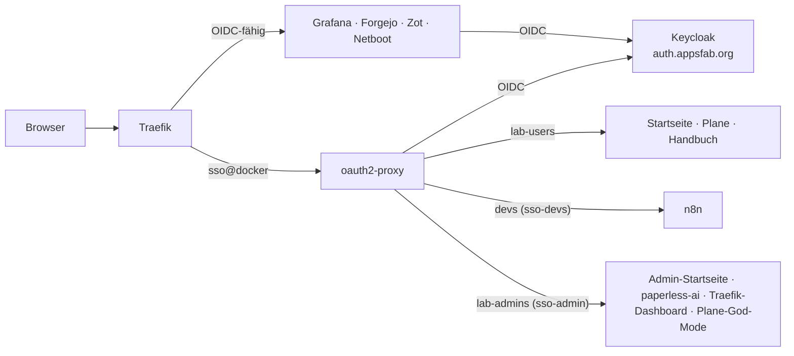

# Login & SSO

Alle Menschen melden sich bei **Keycloak** an (Realm `AppsFab`, Login unter `https://auth.appsfab.org`).
Dienste vertrauen Keycloak auf zwei Wegen:

## Ein Issuer für alles

Der Realm setzt `frontendUrl = https://auth.appsfab.org`. Damit ist
`https://auth.appsfab.org/realms/AppsFab` der Issuer aller Clients, im LAN wie im Internet und für den
Cluster. `auth.lab.appsfab.org` ist nur noch der Server-Hostname für die Admin-Konsole und bleibt im LAN.

Serverseitige Aufrufe an `auth.appsfab.org` (Discovery, Token, JWKS) gehen über den Traefik-Alias im
jeweiligen `edge`-Netz, nicht übers Internet.

## Login-Regeln

| Weg | Was nötig ist |
|---|---|
| Passkey (Autofill oder Button) | nur der Passkey |
| Passwort, Konto hat zweiten Faktor | Passwort **und** Passkey, Sicherheitsschlüssel, OTP oder Recovery-Code |
| Passwort, Konto hat noch keinen zweiten Faktor | danach **Pflicht**: Passkey registrieren |
| Password-Grant (ROPC) | für alle Clients gesperrt |

Selbstregistrierung und „Passwort vergessen“ sind aus. Die WebAuthn-RP-ID ist `appsfab.org`, Passkeys gelten
also für jeden Login-Host unter `appsfab.org`.

## Notausgänge

- **Ausgesperrt aus dem Realm**: Admin-Konsole im LAN (`https://auth.lab.appsfab.org/admin`, Realm `master`)
  öffnen und beim Benutzer Credentials oder Required Actions zurücksetzen.
- **Alter Passkey** (von `auth.lab`) zählt als eingerichteter zweiter Faktor, funktioniert aber nicht mehr:
  in der Account-Konsole löschen, sonst wird er nach dem Passwort verlangt.
- **Keycloak ganz weg**: Forgejo hat einen Notschalter für den Passwort-Login
  ([Forgejo](../dienste/forgejo.md#betrieb)); Grafana hat das lokale Admin-Konto aus 1Password
  (`homelab-grafana`).

Die Flow-Details stehen in [`realm/PASSKEYS.md`](https://github.com/appwerkstatt/homelab-gitops/blob/main/stacks/02-keycloak/realm/PASSKEYS.md).

## Neuen Dienst anbinden

=== "App kann OIDC"

    1. Client im Realm-JSON anlegen (Redirect-URIs, Gruppen-Mapper), `KCC_REALM_REV` hochzählen.
    2. Secret erzeugen, in 1Password ablegen, als `<NAME>_OIDC_CLIENT_SECRET` in `.env.example` eintragen.
    3. Variable in die Arcane-Env von `keycloak` **und** des Dienstes setzen, dann Keycloak deployen, danach den Dienst.

=== "App kann kein OIDC"

    1. Am Router `middlewares=sso@docker` setzen, bei Entwickler-Werkzeugen `sso-devs@docker`, bei Admin-Werkzeugen `sso-admin@docker`
       ([Rechtekonzept](rechtekonzept.md)).
    2. Callback `https://<host>.lab.appsfab.org/oauth2/callback` beim Client `oauth2-proxy` ergänzen,
       `KCC_REALM_REV` hochzählen.
